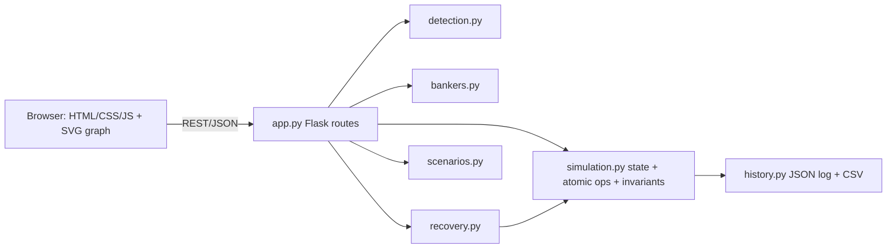

# Architecture

Data flow: UI action -> REST call -> `Simulation` mutation (deep-copy snapshot, rollback on any error, invariant check) -> algorithms read an immutable matrix view (`matrices()`) -> JSON state back -> UI re-renders. Algorithm modules are pure functions with no Flask/UI imports, so they are unit-tested independently.
State model: `resources{name:total}`, `procs{pid:{status,max,alloc,req,priority,cost,progress}}`. Invariant: total = available + sum(alloc); no negatives; alloc+req <= max.
